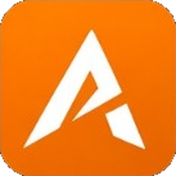

<div align="center">

# AdictosPanel

**Advanced web admin panel for FiveM servers. Multi-server, 100% in the browser.**

*Your server, under control, from anywhere.*

[](https://adictospanel.com/en)
[](https://demo.adictospanel.com/)
[](https://documentation.adictospanel.com/en/)
[](https://discord.adictospanel.com)
[](https://documentation.adictospanel.com/en/installation)
[](https://store.adictospanel.com/panel)

<p align="center"><a href="https://adictospanel.com/en"></a></p>

[Website](https://adictospanel.com/en) · [Live demo](https://demo.adictospanel.com/) · [Documentation](https://documentation.adictospanel.com/en/) · [Store](https://store.adictospanel.com/) · [Discord](https://discord.adictospanel.com) · [vs txAdmin](https://adictospanel.com/en/funciones/vs-txadmin)

</div>

---

## What is AdictosPanel?

AdictosPanel is a web administration panel for FiveM servers. Your staff can manage players, sanctions, logs, tickets, inventories, vehicles and a live map from any browser, with secure Steam login.

The panel is a website, not a second Lua resource. Your server connects to it through **Adictos_WebLogs**, a free FiveM resource that sends server logs to the panel and syncs webhooks and categories from it.

## Main features

| | Feature | What it does |
|---|---|---|
| 📊 | **Web dashboard** | Real-time metrics, recent activity and a 24-hour server summary |
| 👥 | **Player management** | Profiles, connection history, bans, warnings, kicks and CKs, all centralized and filterable |
| 🎮 | **In-game menu (`/apm`)** | Players, sanctions, spectate, vehicles and staff tools, synced with the web panel |
| 🗺️ | **Live map** | Interactive 2D GTA map with player and vehicle positions, plus a 3D view |
| 📺 | **Live Monitor** | Watch several player screens at once to supervise roleplay |
| 📝 | **Logs & sanctions** | Full server event log by category, with optional Discord webhooks per category |
| 🎫 | **Tickets & support** | In-game (`/report`), web and Discord tickets with real-time chat and templates |
| 📦 | **Inventory & vehicles** | Player items, trunks and gloveboxes, movement history and a global vehicle list |
| 🖥️ | **Multi-server** | Several servers from one account, with staff roles and permissions per server |
| 🛡️ | **Access control** | Configurable staff roles, granular permissions and Steam (OpenID) authentication |
| 🎨 | **Custom themes** | Restyle the web panel and the in-game NUIs (`/apm` and tickets) |
| 📡 | **Network & ping** | Per-player ping history, hourly and weekly averages, and a timeout ranking |
| ⭐ | **Discord VIP** | Assign, extend or remove temporary Discord roles from the panel |
| 🎁 | **Discord giveaways** | Join button, multiple winners, and VIP or item prizes |
| 🏆 | **Discord ranking** | Leaderboards with category buttons and pagination (up to 2 panels per server) |
| ✈️ | **Mass give** | Send items to many players' return lockers at once |
| 💬 | **Integrated DiscordBot** | Configurable slash command, expiry warnings, a command channel and Discord-only staff roles |

## Compatibility

- **Frameworks:** ESX (Legacy, `es_extended`), QBCore (`qb-core`), Qbox (`qbx_core`). The resource detects the active one automatically.
- **Inventories:** `ox_inventory`, `qb-inventory` (and the ps/lj forks), with automatic detection or a manual override in *My servers → Framework*.
- **Required dependencies:** `oxmysql` and `ox_lib`.

## Quick install

> Full guide: **[documentation.adictospanel.com/en/installation](https://documentation.adictospanel.com/en/installation)**

1. Sign in at [adictospanel.com](https://adictospanel.com/en) with Steam. Your account is created on the Free plan.
2. Download **Adictos_WebLogs** from Cfx.re / Tebex ([store page](https://store.adictospanel.com/p/adictos-weblogs)) and put it in `resources/`.
3. Add it to `server.cfg` **after** your framework, `oxmysql` and `ox_lib`:

   ```cfg
   ensure es_extended   # or qb-core / qbx_core
   ensure oxmysql
   ensure ox_lib
   ensure Adictos_WebLogs
   ```

4. Start the server. The console prints a `/link/ABC-DEF` URL, valid for 15 minutes. Open it with the owner's Steam account to pair the server. No token or `setr` is needed in `server.cfg`.
5. Check that events arrive in **Logs → GENERAL**.
6. *(Optional, Premium)* Pay on Tebex and paste your `tbx-…` ID on the link page or in *My subscriptions*.

> ⚠️ On Linux, don't upload the resource with FileZilla because it can corrupt permissions. Use WinSCP or SFTP in binary mode.

## Plans

| | **Free** | **Premium** |
|---|---|---|
| Price | 0 € | 9,99 € / month |
| Servers per account | 1 | 3 |
| Log retention | 14 days | 90 days |
| Discord webhooks per server | 15 | 50 |
| Custom roles per server | 3 | 10 |
| Bans, kicks, warnings, logs, inventory & vehicles, `/apm`, in-game & web tickets, mass give | ✓ | ✓ |
| Live Monitor, live map, Discord tickets, CK, license transfer, Discord VIP, giveaways, ranking, custom themes, network history | — | ✓ |

Payments are processed by [Tebex](https://www.tebex.io/), the Merchant of Record. Full and current details are on the [store](https://store.adictospanel.com/panel).

## AdictosPanel vs txAdmin

AdictosPanel **doesn't replace txAdmin, it complements it.** txAdmin starts, restarts and monitors the FXServer process and gives you a live console. AdictosPanel doesn't do any of that. Instead it gives your staff web and Discord tools: logs with context, a live map, inventories, tickets, VIP roles and several servers in one account. You can run both together without conflicts.

👉 Read the full comparison: [English](https://adictospanel.com/en/funciones/vs-txadmin) · [Español](https://adictospanel.com/funciones/comparativa-txadmin)

## Links

- 🌐 Website: <https://adictospanel.com>
- 🧪 Live demo (nothing to install): <https://demo.adictospanel.com>
- 📘 Documentation: <https://documentation.adictospanel.com>
- 🛒 Store: <https://store.adictospanel.com>
- 💬 Discord (support and news): <https://discord.adictospanel.com>

---

## 🇪🇸 En español

**AdictosPanel** es un panel web de administración para servidores FiveM. Desde el navegador gestionas jugadores, sanciones, logs, tickets, inventarios, vehículos y un mapa en vivo, y el staff entra con su cuenta de Steam. Es multiservidor y funciona con ESX, QBCore y Qbox, además de con ox_inventory y qb-inventory.

Para conectarlo, instala el recurso gratuito **Adictos_WebLogs** desde Cfx.re o Tebex. Ponlo con `ensure` en `server.cfg` después del framework, `oxmysql` y `ox_lib`, y abre con Steam el enlace `/link/...` que aparece en la consola. Hay un plan Free y otro Premium por 9,99 €/mes.

[Web](https://adictospanel.com) · [Demo](https://demo.adictospanel.com) · [Documentación](https://documentation.adictospanel.com) · [Guía de instalación](https://documentation.adictospanel.com/installation) · [Tienda](https://store.adictospanel.com) · [Discord](https://discord.adictospanel.com) · [Comparativa con txAdmin](https://adictospanel.com/funciones/comparativa-txadmin)

---

<sub>txAdmin is a Cfx.re project and has no affiliation with AdictosPanel. © 2026 AdictosPanel.</sub>
